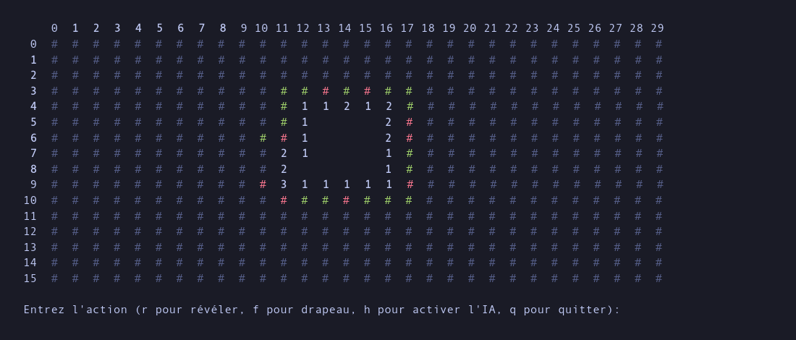

# MineSweeper

A terminal Minesweeper in C with an AI assistant that computes the probability
of each hidden cell being a mine.



With the AI on, hidden cells are colored by risk: **green** is guaranteed safe,
**red** is a guaranteed mine, and **gray** is uncertain.

## Build and run

You need a C compiler and the math library.

```sh
gcc -O2 -o minesweeper minesweeper.c probabilities.c -lm
./minesweeper
```

The board is 16 × 30 with 99 mines (expert). Your first reveal is always safe.

| Key | Action |
|---|---|
| `r x y` | Reveal the cell at row `x`, column `y` |
| `f x y` | Toggle a flag |
| `h` | Toggle AI hints |
| `q` | Quit |

## Comment fonctionne l'IA

Même en jouant parfaitement, le démineur reste un jeu de hasard : il arrive qu'aucune
case ne soit sûre. L'IA ne cherche donc pas seulement les coups certains, elle calcule
pour chaque case cachée la probabilité qu'elle contienne une mine.

La première idée, tester toutes les répartitions de mines possibles autour des chiffres
révélés (c'est le prototype `proba.py`), devient vite inutilisable : le nombre de
combinaisons explose avec la taille de la zone découverte. On reformule donc le problème
en algèbre linéaire. Avec `A` la matrice d'adjacence de la grille et `B` le vecteur qui
vaut 1 là où se trouve une mine, chaque chiffre révélé impose `A · B = v` sur sa ligne.
On ne garde que les lignes des cases révélées et les colonnes des cases cachées qui
touchent au moins un chiffre.

L'astuce principale est de regrouper les cases cachées qui ont exactement la même
colonne dans `A`, c'est-à-dire qui voisinent les mêmes chiffres : elles ont forcément
la même probabilité, et on ne raisonne plus que sur le nombre de mines par groupe. Le
système, beaucoup plus petit, est réduit par l'élimination de Gauss-Jordan. Les variables
libres sont bornées entre 0 et la taille de leur groupe, ce qui permet d'énumérer toutes
les solutions valides. Chaque solution est pondérée par le nombre de façons de placer
ses mines dans les groupes (un produit de coefficients binomiaux), et la probabilité
d'une case est la proportion moyenne de mines dans son groupe, sur l'ensemble des
solutions.

Les cases sans aucun chiffre voisin ne sont pas estimées, et le nombre total de mines
restantes n'est pas encore pris en compte. Le [rapport](rapport.pdf) détaille le
raisonnement sur un exemple complet.

## Layout

- `minesweeper.c`: board, mine placement, display, and game loop.
- `probabilities.c`: the matrix-based probability solver.
- `proba.py`: a brute-force Python prototype of the solver.
- `rapport.pdf`: the project report (in French).
- `rapport/`: LaTeX sources of the report.
